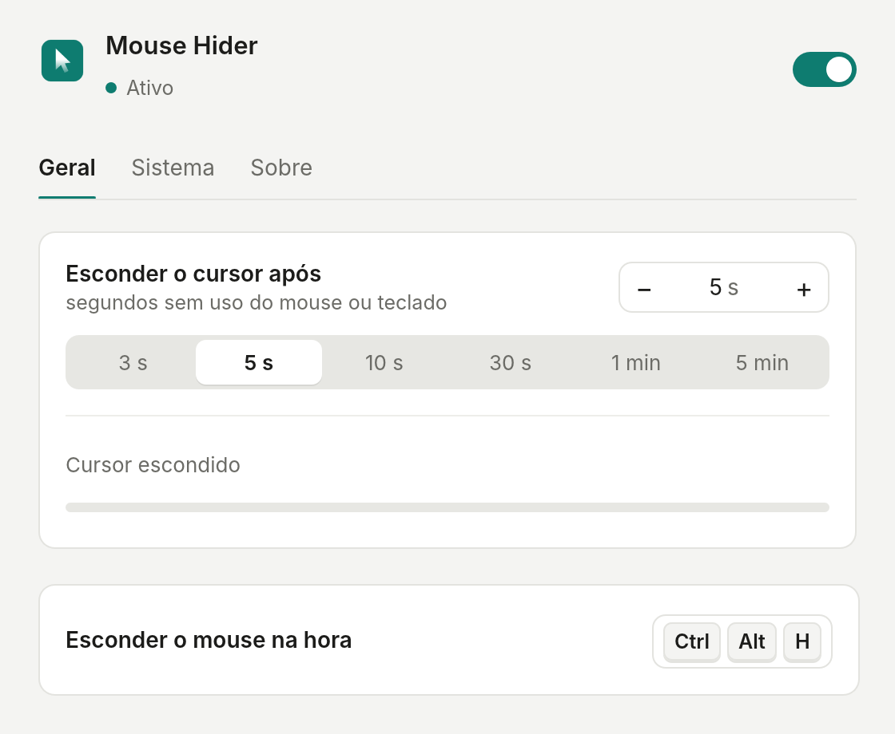
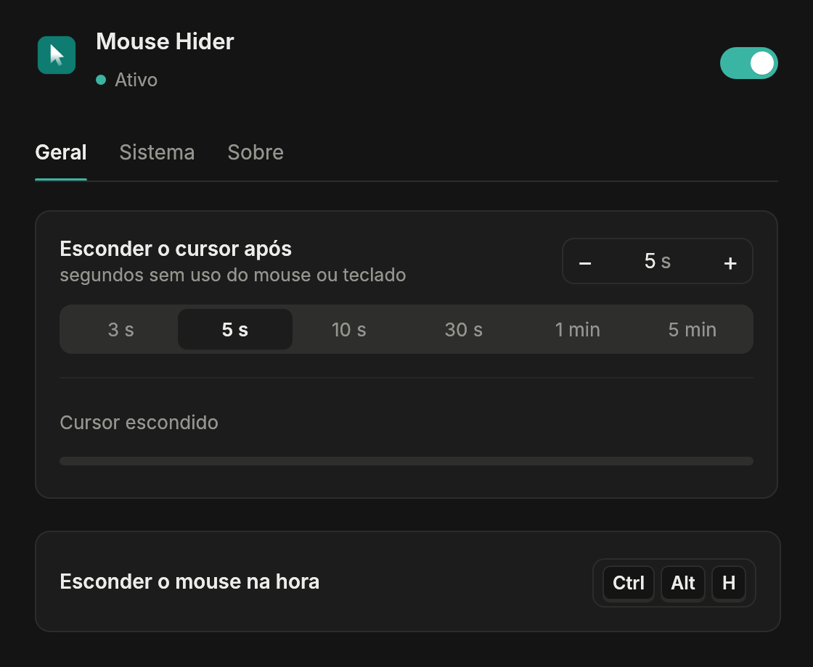
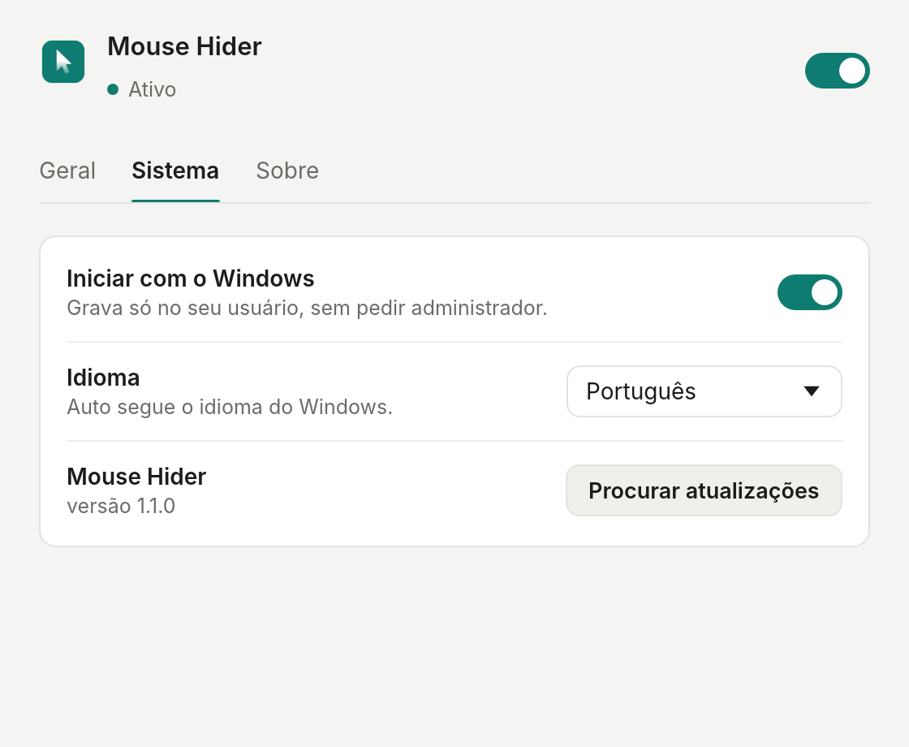
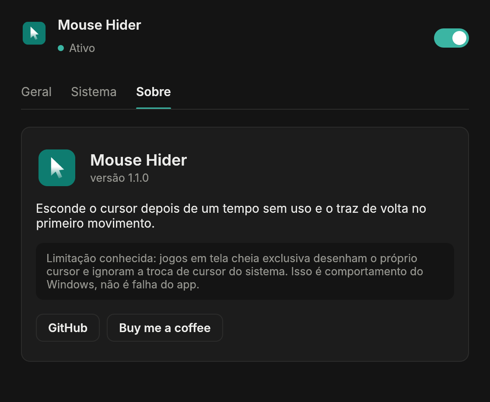

<p align="center">
  
</p>

<h1 align="center">Mouse Hider</h1>

<p align="center">
  <b>Hides the mouse cursor after a few idle seconds and brings it back on the first move.
  One tray <code>.exe</code> for Windows: no installer, no administrator, no account, no
  cloud, no telemetry.</b>
</p>

<p align="center">
  <a href="https://github.com/asguth/mouse-hider/releases/latest"></a>
  <a href="https://github.com/asguth/mouse-hider/actions/workflows/ci.yml"></a>
  
  
  <a href="LICENSE"></a>
  <a href="https://buymeacoffee.com/mousehider"></a>
</p>

<p align="center"><a href="README.md">Português</a> · <b>English</b></p>

<p align="center">
  
  
</p>

<p align="center">
  <a href="#install">Install</a> ·
  <a href="#what-it-does">What it does</a> ·
  <a href="#the-cursor-always-comes-back">The cursor always comes back</a> ·
  <a href="#updates">Updates</a> ·
  <a href="#how-it-works">How it works</a> ·
  <a href="#faq">FAQ</a>
</p>

---

## Install

Three ways, simplest first. None of them asks for administrator rights.

**1. PowerShell (recommended, no warnings at all).** Paste into PowerShell and press Enter:

```powershell
$d = "$env:LOCALAPPDATA\Programs\MouseHider"; New-Item -ItemType Directory -Force $d | Out-Null; Invoke-WebRequest https://github.com/asguth/mouse-hider/releases/latest/download/MouseHider.exe -OutFile "$d\MouseHider.exe"; Start-Process "$d\MouseHider.exe"
```

It downloads the exe into your user folder and starts it. Files downloaded by PowerShell
don't get the "came from the internet" mark, so SmartScreen stays quiet. Then turn on
**Start with Windows** in the System tab.

**2. Download the exe.** [**MouseHider.exe**](https://github.com/asguth/mouse-hider/releases/latest/download/MouseHider.exe)
· Windows 10/11 x64 · ~6 MB. Put it in any folder of yours (not *Program Files*) and run it.
The first time, SmartScreen may say "Windows protected your PC": **More info → Run anyway**.
Only once ([why](#antivirus-and-smartscreen)).

**3. Build from source.** With [Rust](https://rustup.rs):

```powershell
git clone https://github.com/asguth/mouse-hider
cd mouse-hider
cargo build --release
.\target\release\MouseHider.exe
```

> Settings live in `%AppData%\MouseHider` and, if you ask for it, a `HKCU\...\Run` entry to
> start with Windows. Nothing outside your user account.

## What it does

| | |
|---|---|
| **Hide when idle** | 1 second to 1 hour without mouse or keyboard, with 3 s to 5 min presets |
| **Back on the first move** | Checked every 50 ms: no noticeable delay |
| **Live countdown** | A bar that resets on every move |
| **Global shortcut** | Hide right away with the combination you pick (default `Ctrl` `Alt` `H`) |
| **Pause** | From the switch at the top of the window or the tray menu; the icon turns grey |
| **Updates** | Downloads the new exe, checks its SHA-256 and swaps itself ([details](#updates)) |
| **Start with Windows** | Optional, current user only |
| **11 languages** | Português, English, Español, Français, Deutsch, Italiano, Русский, 日本語, 中文, 한국어, or Windows' own |
| **Light and dark** | Follows the system theme |

**Tray:** click the icon to open the window; right-click for the menu (General, System,
About, Pause, Close). Minimizing sends the window to the tray; **X** quits the app. Launched from the exe, it shows the window; via *Start with Windows*,
it starts as just the tray icon.

<p align="center">
  
  
</p>

## The cursor always comes back

That's the requirement the whole project is built around. The cursor is restored when you
close the app, lock the screen or switch users, sign out or shut down, if the app panics,
and — if the process is killed outright — on the next launch, through the sentinel file
`%AppData%\MouseHider\cursor-hidden.flag`. If the cursor ever vanishes with the app closed,
opening Mouse Hider again fixes it.

## Updates

**Check for updates** (System tab) asks the GitHub releases API for the latest tag. If there
is a newer one, the button becomes **Update now**:

1. Downloads `MouseHider.exe` from the release next to the current one, showing progress.
2. Checks the SHA-256 against the `digest` the API publishes. It doesn't protect against a
   compromised GitHub, but catches truncated downloads, proxies returning error pages with
   HTTP 200 and poisoned caches. Mismatch, file discarded.
3. Renames the running exe to `.old` (Windows allows renaming, not overwriting), puts the
   new one in place, starts it and exits. The new version waits for the old one, deletes
   the `.old` file and opens its window so you can see it worked.

Nothing runs in the background: only after you click.

## Antivirus and SmartScreen

The exe is a plain native binary, with no packer or self-extractor — the cause of the false
positives in the old .NET build. There is no keyboard or mouse hook: idle time comes from
`GetLastInputInfo`. What's still missing for zero warnings is a code-signing certificate, so
SmartScreen warns about **browser downloads**. The PowerShell route skips that because the
file isn't tagged as coming from the internet.

## How it works

```
GetLastInputInfo every 50 ms ─▶ over the limit? ─▶ SetSystemCursor (transparent cursor)
                               └─ moved again?  ─▶ SystemParametersInfo(SPI_SETCURSORS)
```

The window is [egui](https://github.com/emilk/egui) with custom controls; the tray is
`tray-icon`; everything else is plain Win32 through `windows-sys`. `src/nucleo` holds the
platform-independent logic and its tests, `src/win` the Windows side, `src/ui` the window.
See the [Portuguese README](README.md#como-funciona) for the file-by-file map.

```powershell
cargo test                               # logic tests (run on any OS)
cargo run                                # the app
.\target\debug\MouseHider.exe --selftest # hides and restores the real cursor, exits 0 or 1
```

## FAQ

**Admin rights?** Never.

**Uninstall?** Turn off *Start with Windows*, close it from the tray menu and delete the
exe's folder. To leave nothing behind, also delete `%AppData%\MouseHider`.

**Coming from 1.0.x (with installer)?** Uninstall it in *Settings → Apps* and install with
the PowerShell line above. Your settings carry over.

**Games?** Windowed and borderless fullscreen work. Exclusive fullscreen games draw their own
cursor and ignore the system cursor swap — that's Windows behaviour, not an app fault.

## Support

Free, and it'll stay that way. If it helped, you can
[buy me a coffee](https://buymeacoffee.com/mousehider), leave a ⭐, or
[open an issue](https://github.com/asguth/mouse-hider/issues/new) when something breaks.

## License

[MIT](LICENSE).
