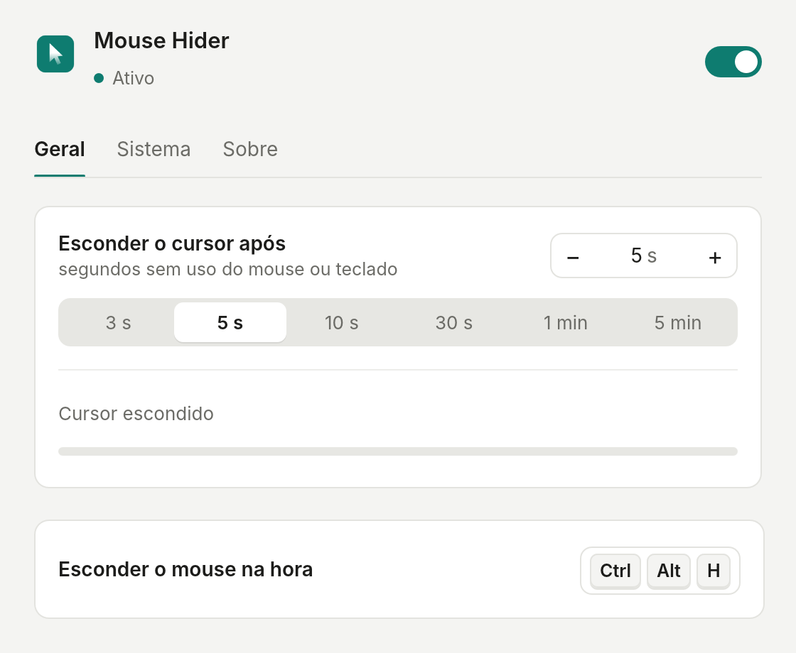
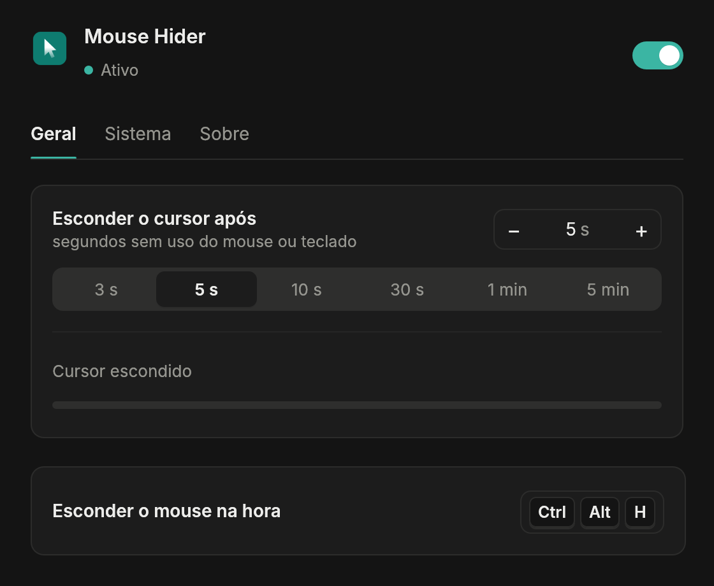
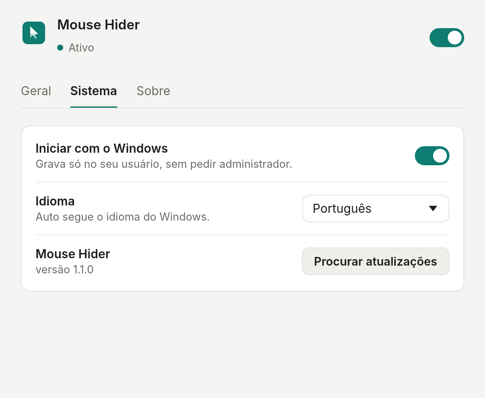
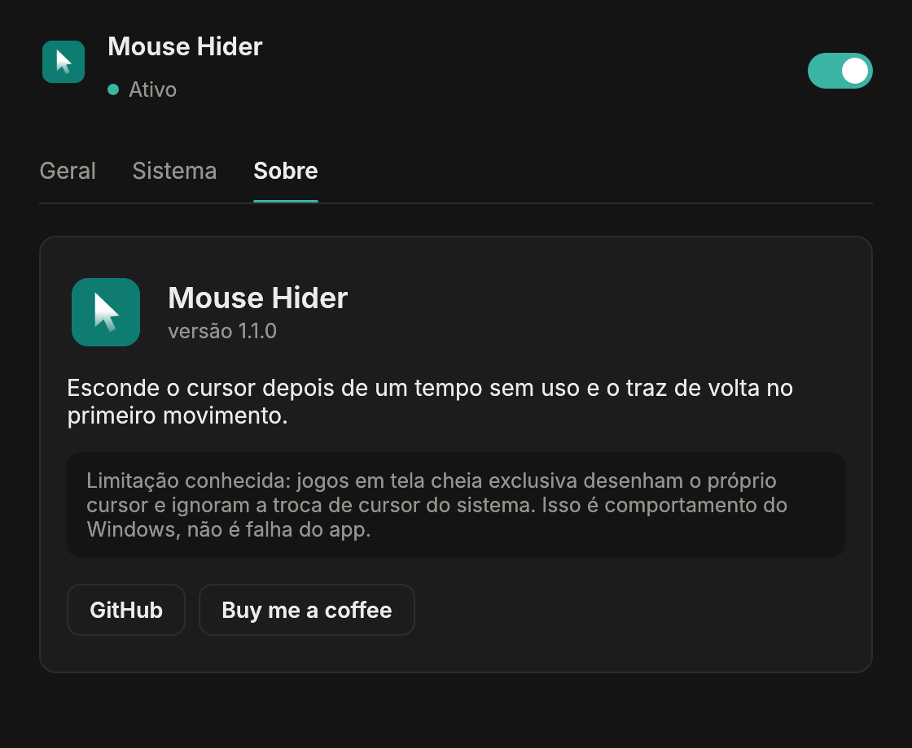

<p align="center">
  
</p>

<h1 align="center">Mouse Hider</h1>

<p align="center">
  <b>Esconde o cursor do mouse depois de alguns segundos sem uso e traz de volta no primeiro
  movimento. Um único <code>.exe</code> de bandeja para Windows: sem instalador, sem
  administrador, sem conta, sem nuvem, sem telemetria.</b>
</p>

<p align="center">
  <a href="https://github.com/asguth/mouse-hider/releases/latest"></a>
  <a href="https://github.com/asguth/mouse-hider/actions/workflows/ci.yml"></a>
  
  
  <a href="LICENSE"></a>
  <a href="https://buymeacoffee.com/mousehider"></a>
</p>

<p align="center"><b>Português</b> · <a href="README.en.md">English</a></p>

<p align="center">
  
  
</p>

<p align="center">
  <a href="#instalação">Instalação</a> ·
  <a href="#o-que-faz">O que faz</a> ·
  <a href="#telas">Telas</a> ·
  <a href="#o-cursor-sempre-volta">O cursor sempre volta</a> ·
  <a href="#atualização">Atualização</a> ·
  <a href="#como-funciona">Como funciona</a> ·
  <a href="#perguntas-frequentes">FAQ</a> ·
  <a href="#apoie-o-projeto">Apoie</a>
</p>

---

## Instalação

São só três jeitos, do mais simples ao mais manual. Nenhum pede administrador.

**1. PowerShell (recomendado, sem nenhum aviso).** Cole no PowerShell e dê Enter:

```powershell
$d = "$env:LOCALAPPDATA\Programs\MouseHider"; New-Item -ItemType Directory -Force $d | Out-Null; Invoke-WebRequest https://github.com/asguth/mouse-hider/releases/latest/download/MouseHider.exe -OutFile "$d\MouseHider.exe"; Start-Process "$d\MouseHider.exe"
```

Baixa o exe para a sua pasta de usuário e abre. Arquivo baixado pelo PowerShell não ganha a
marca de "veio da internet", então o SmartScreen não aparece. Depois, ligue **Iniciar com o
Windows** na aba Sistema.

**2. Baixar o exe.** [**MouseHider.exe**](https://github.com/asguth/mouse-hider/releases/latest/download/MouseHider.exe)
· Windows 10/11 x64 · ~6 MB. Coloque em qualquer pasta sua (não em *Arquivos de Programas*)
e abra. Na primeira vez o SmartScreen pode mostrar "O Windows protegeu o computador":
**Mais informações → Executar assim mesmo**. Uma vez só ([por quê](#antivírus-e-smartscreen)).

**3. Compilar do código.** Com [Rust](https://rustup.rs) instalado:

```powershell
git clone https://github.com/asguth/mouse-hider
cd mouse-hider
cargo build --release
.\target\release\MouseHider.exe
```

> O app grava a configuração em `%AppData%\MouseHider` e, se você pedir, uma entrada em
> `HKCU\...\Run` para iniciar com o Windows. Nada fora do seu usuário.

## O que faz

| | |
|---|---|
| **Esconde por inatividade** | De 1 segundo a 1 hora sem mouse nem teclado, com atalhos de 3 s a 5 min |
| **Volta no primeiro movimento** | Checagem a cada 50 ms: o cursor aparece sem atraso perceptível |
| **Contador ao vivo** | Barra regressiva que reinicia a cada movimento |
| **Atalho global** | Esconde na hora com a combinação que você escolher (padrão `Ctrl` `Alt` `H`) |
| **Pausar** | Pelo interruptor no topo da janela ou pelo menu da bandeja; o ícone fica cinza |
| **Atualização** | Baixa o exe novo, confere o SHA-256 e troca sozinho ([detalhes](#atualização)) |
| **Iniciar com o Windows** | Opcional, só no seu usuário |
| **11 idiomas** | Português, English, Español, Français, Deutsch, Italiano, Русский, 日本語, 中文, 한국어, ou o do Windows |
| **Claro e escuro** | Segue o tema do sistema |

**Bandeja:** clique no ícone para abrir a janela. O botão direito abre o menu, que espelha as
abas (Geral, Sistema, Sobre), mais Pausar e Fechar. Minimizar a janela manda para a bandeja;
o **X** encerra o app. Aberto pelo exe, o app mostra a janela; pelo *Iniciar com o Windows*,
começa só no ícone da bandeja.

## Telas

<p align="center">
  
  
</p>

**Sistema** — iniciar com o Windows, idioma e atualização. **Sobre** — versão, a limitação
conhecida e os links.

## O cursor sempre volta

É o requisito que manda no projeto. O cursor é restaurado:

| Quando | Como |
|---|---|
| Ao fechar o app, pela janela ou pela bandeja | Restauração explícita antes de sair |
| Ao travar a tela ou trocar de usuário | Notificação de sessão (`WM_WTSSESSION_CHANGE`) |
| Ao desligar, reiniciar ou sair da conta | `WM_QUERYENDSESSION` / `WM_ENDSESSION` |
| Se o app der pânico | Hook de pânico restaura antes de encerrar |
| Se o processo for morto à força | A sentinela `%AppData%\MouseHider\cursor-hidden.flag` denuncia na próxima abertura, e o cursor volta antes de qualquer outra coisa |

Se o cursor sumir e o app não estiver aberto, abrir o Mouse Hider de novo resolve.

## Atualização

Na aba **Sistema**, **Procurar atualizações** consulta a API de releases do GitHub e compara a
tag mais recente com a versão do app. Havendo versão nova, o mesmo botão vira **Atualizar
agora**:

1. Baixa o `MouseHider.exe` do release para a pasta do app, mostrando a porcentagem.
2. Confere o SHA-256 contra o `digest` que a API publica para o arquivo. Isso não protege
   contra um GitHub comprometido (o hash vem da mesma resposta que deu a URL), mas pega
   download truncado, proxy que devolve página de erro com HTTP 200 e cache envenenado.
   Hash diferente, arquivo descartado.
3. Renomeia o exe em uso para `.old` (o Windows permite renomear, só não sobrescrever),
   põe o novo no lugar, abre a versão nova e sai. A nova espera a antiga fechar, apaga o
   `.old` e abre a janela para você ver que deu certo.

Nada roda em segundo plano: só depois do clique. Se o exe estiver numa pasta sem permissão de
escrita, ou o release não tiver o exe anexado, o botão abre a página do release no navegador.

## Antivírus e SmartScreen

O exe é um binário nativo comum, sem compactador e sem auto-extração — a causa dos falsos
positivos da versão .NET antiga. Ele não tem hook de teclado nem de mouse: a inatividade é
lida por `GetLastInputInfo`, o que evita a cara de keylogger para heurísticas.

O que ainda falta para zerar avisos é um certificado de assinatura de código. Sem ele, o
SmartScreen avisa "editor desconhecido" em arquivos **baixados pelo navegador**. O jeito do
PowerShell acima não passa por isso, porque o arquivo não recebe a marca de origem da
internet. Falsos positivos podem ser reportados em
<https://www.microsoft.com/en-us/wdsi/filesubmission>.

## Como funciona

```
GetLastInputInfo a cada 50 ms ─▶ passou do limite? ─▶ SetSystemCursor (cursor transparente)
                                └─ mexeu de novo?  ─▶ SystemParametersInfo(SPI_SETCURSORS)
```

| Arquivo | Responsabilidade |
|---|---|
| [`src/win/cursor.rs`](src/win/cursor.rs) | Troca os 13 cursores do sistema por um transparente e restaura do registro |
| [`src/win/motor.rs`](src/win/motor.rs) | Laço de 50 ms numa thread própria; decide esconder ou mostrar |
| [`src/win/sinal.rs`](src/win/sinal.rs) | Janela oculta: atalho global, bloqueio de tela, fim de sessão, segunda instância |
| [`src/win/bandeja.rs`](src/win/bandeja.rs) | Ícone e menu da bandeja |
| [`src/win/mod.rs`](src/win/mod.rs) | Instância única, início oculto, minimizar para a bandeja, troca do exe na atualização |
| [`src/ui/`](src/ui) | A janela, em [egui](https://github.com/emilk/egui): paleta, controles próprios e as três abas |
| [`src/nucleo/`](src/nucleo) | O que não depende do Windows: config, textos, atalho, aritmética, logo, atualização |

Decisões que vale saber:

- **Sem hook global.** Polling de `GetLastInputInfo` é mais leve e não parece keylogger. O
  intervalo de 50 ms é a latência com que o cursor volta.
- **Fontes do sistema.** A janela usa Segoe UI (e Yu Gothic, Microsoft YaHei e Malgun Gothic
  para japonês, chinês e coreano), lidas do disco por mapeamento de memória. Nada embutido.
- **Sem ícone binário para manter.** O logo é desenhado por código; `MouseHider.exe
  --makeicon` regera o `assets/MouseHider.ico`.
- **Configuração compatível.** O `config.json` mantém os nomes da versão .NET, então quem
  atualiza não perde nada.

## Desenvolvimento

```powershell
cargo test                               # testes da lógica (rodam em qualquer sistema)
cargo run                                # o app
.\target\debug\MouseHider.exe --selftest # esconde e restaura o cursor de verdade, sai com 0 ou 1
```

Fora do Windows, `cargo run` abre só a janela, com dados falsos, para mexer na interface:
`cargo run -- --aba sistema --tema escuro --idioma en`.

**Publicar uma versão:** `.\scripts\release.ps1 1.2.0` grava a versão no `Cargo.toml`, roda
os testes e o selftest, cria a tag e envia. O GitHub Actions compila e anexa o
`MouseHider.exe` ao release. O nome do arquivo nunca muda, então o link de download também
não.

## Perguntas frequentes

**Precisa de administrador?** Não, em momento nenhum.

**Como desinstalar?** Desligue *Iniciar com o Windows*, feche pelo menu da bandeja e apague a
pasta do exe. Para não deixar rastro, apague também `%AppData%\MouseHider`.

**Eu tinha a versão 1.0.x com instalador.** Desinstale em *Configurações → Aplicativos* e
instale pelo PowerShell acima. A configuração continua valendo. A 1.0.x não sabe se
atualizar para o formato sem instalador: o botão dela abre a página do release.

**Funciona em jogos?** Em janela e tela cheia sem borda, sim. Em tela cheia exclusiva, não:
o jogo desenha o próprio cursor e ignora a troca de cursor do sistema. É comportamento do
Windows, não falha do app.

**E cursores personalizados?** O app troca os 13 cursores padrão do Windows e, ao restaurar,
recarrega o esquema que você usa. Cursores próprios de um programa específico continuam
visíveis: não existe API pública para trocá-los.

**Consome muito?** Um tique a cada 50 ms que lê um número do sistema. Com a janela fechada,
a interface não desenha nada.

## Apoie o projeto

O Mouse Hider é gratuito e vai continuar assim. Se ele te ajudou, dá para apoiar com um café:

<p align="center">
  <a href="https://buymeacoffee.com/mousehider"></a>
</p>

Ou deixe uma ⭐ e [abra uma issue](https://github.com/asguth/mouse-hider/issues/new) quando
achar um erro.

## Licença

[MIT](LICENSE).
